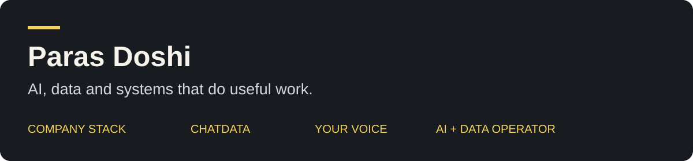

# Hi, I’m Paras Doshi

I build tools for working with AI, checking what it actually did, and carrying the learning into the next run.

My work connects three questions: **What should the agent do? What does the evidence support? How should we explain it?** Start with the project closest to your work.

## Four places to start

| Project | Use it when you want to… | First useful step |
|---|---|---|
| **[Company Stack](https://github.com/parasdoshicom/zero-human-company-os)** | Operate a small digital-product business with bounded agent tasks and checked outcomes | [Run the local company demo](https://github.com/parasdoshicom/zero-human-company-os/blob/main/docs/demo.md) |
| **[ChatData](https://github.com/parasdoshicom/getchatdata)** | Analyze data, challenge the conclusion, and keep reusable evidence | [Install the skills and try synthetic data](https://github.com/parasdoshicom/getchatdata#install) |
| **[Your Voice](https://github.com/parasdoshicom/your-voice)** | Write blogs, guides, updates and explanations that preserve meaning and sound like you | [Read the skill](https://github.com/parasdoshicom/your-voice/blob/main/SKILL.md) |
| **[World-Class AI + Data Operator](https://github.com/parasdoshicom/ai-plus-data)** | Lead AI and data work: strategy, trusted metrics, operating cadence and adoption | [Explore the public operator portfolio](https://github.com/parasdoshicom/ai-plus-data) |

## Try one with your agent

Open one of the four repositories and give your agent this prompt:

```text
Read the README and the linked getting-started guide.
Tell me what I can run locally, what needs setup, and what success looks like.
Help me complete one small example and inspect the result.
Keep my data private and ask before taking an external action.
```

Start with the synthetic examples where provided. Bring your own context once you understand the workflow and its checks.

## Use them together

Company Stack structures the work. ChatData helps establish what the numbers support. Your Voice helps turn those facts into useful writing. The AI + Data Operator portfolio brings those practices into leadership decisions and team operating habits.

For example: investigate a checkout drop with ChatData, choose one bounded experiment in Company Stack, then use Your Voice to draft a guide or customer-facing explanation. Review the claims and approve the destination before publishing. A good draft, a delivered message and a paid order are different results.

## Browse by the job

- **Run a company experiment:** [five operating judgments](https://github.com/parasdoshicom/zero-human-company-os/tree/main/principles), [worked example](https://github.com/parasdoshicom/zero-human-company-os/blob/main/docs/worked-example.md), [first pilot](https://github.com/parasdoshicom/zero-human-company-os/blob/main/docs/pilot-plan.md).
- **Build trustworthy analytics:** [ChatData capabilities](https://github.com/parasdoshicom/getchatdata/blob/main/docs/capabilities.md) and [AI + Data Operator playbooks](https://github.com/parasdoshicom/ai-plus-data/tree/main/playbooks).
- **Improve the writing:** [writing briefs](https://github.com/parasdoshicom/your-voice/blob/main/references/writing-briefs.md), [editing workflows](https://github.com/parasdoshicom/your-voice/blob/main/references/writing-workflows.md), [your own voice profile](https://github.com/parasdoshicom/your-voice/blob/main/references/voice-profile-template.md).
- **Learn by doing:** [try the synthetic analytics example](https://github.com/parasdoshicom/ai-plus-data/tree/main/examples/synthetic-funnel).

## What running the work has taught me

Break a broad goal into a system. Fix the brittle execution path. Check the destination instead of trusting a success report. Make a new tool earn its switching cost. Turn repeated corrections into checks the next run actually uses.

I write about these experiments at [Insight Extractor](https://www.insightextractor.com/). [The tiny AI company essay](https://www.insightextractor.com/p/dont-spend-5000-on-an-ai-course-start) is the background to Company Stack.

[LinkedIn](https://www.linkedin.com/in/doshiparas/) · [Writing](https://www.insightextractor.com/) · [Project map](PROJECTS.md)
